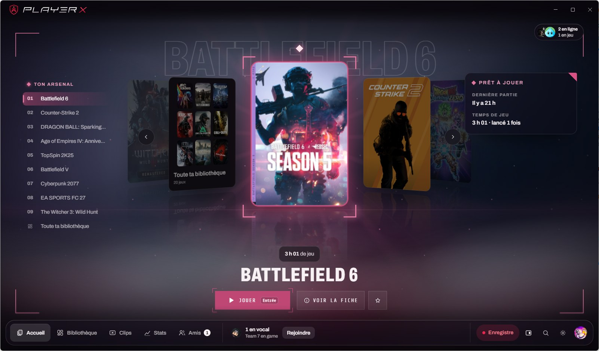

# Player X

Lanceur de jeux pour Windows : il réunit les jeux du PC, les lance, enregistre des clips, en monte des films et affiche
un overlay en partie sur Counter-Strike 2.

## Installer

Lancer `Player-X-Installer-<version>.exe` (ou `Player-X-Setup-<version>.exe`) sous Windows 10 ou 11. Rien d'autre à
installer. Pas encore de mise à jour automatique : une nouvelle version s'installe par-dessus.

## Licences

- FFmpeg 9.0.2, livré avec l'appli pour le montage : GNU LGPL v3 ou ultérieure (version fixée dans
  `src/shared/ffmpegPin.json`).
- Polices : `v3ui/fonts/licences/`.

## Documentation technique

`docs/ARCHITECTURE.md` et `NOTES.md`.
