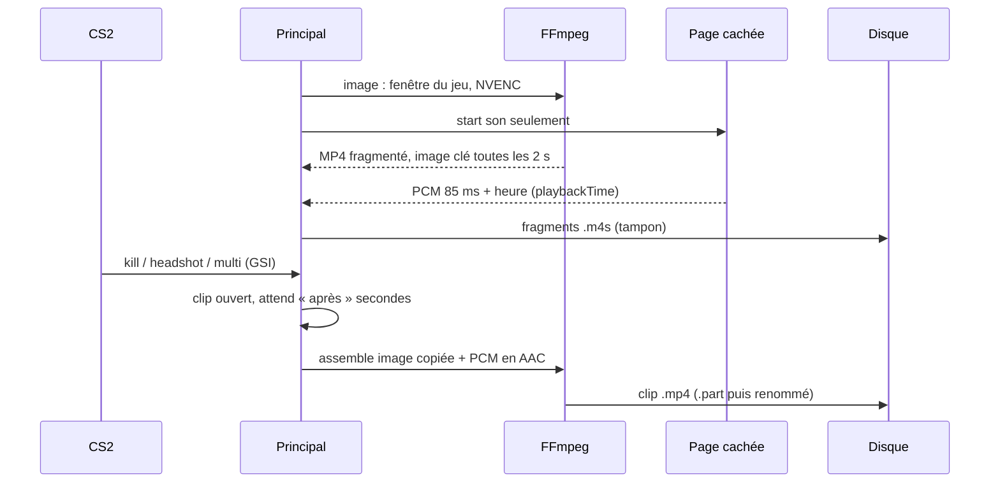

# Architecture de Player X V3 Test (bêta 43)

Version avec schémas : la page « Player X V3 Test, architecture » (artifact du compte de Breezydev). Ce fichier en est la copie texte.

## Processus et ponts

- Un seul processus principal fait le travail. Chaque fenêtre ne reçoit que son pont (`contextBridge`).
- La page de capture a une politique de contenu stricte : scripts du fichier local seulement.
- FFmpeg est livré avec l'appli, son empreinte est vérifiée avant chaque lancement (`src/shared/ffmpegPin.json`).

## 1. Lancer un jeu
`scanAllGames` (Steam, Epic, EA, GOG en parallèle) → bibliothèque → `launchTarget` (lien du magasin, ou exe + arguments pour GOG) → `handoff` (Windows) → `launches.ts` suit les états `sending → waiting → (relay) → running → ended` (autres : early-exit, gave-up, failed, already, resent, cancelled, untracked) ; `playtime` et `tracking` reconnaissent le jeu par son exécutable.

## 2. Faire un clip

- Essais d'image : fenêtre du jeu → écran WGC → copie de bureau ; NVENC puis AMF ; si rien ne marche, retour à la capture de Chrome.
- À ne pas refaire : `scale_d3d11` ; recoller le son de MediaRecorder ; compter les morceaux de son reçus au lieu d'utiliser `playbackTime`.

## 3. Monter un film
Page Clips (sélection) → éditeur `edit.js` (musique, rythme, déplacer, ralentir, supprimer) → `detectBeats` → `planProject` / `editShots` → `shotArgs` + `joinArgs` → `editFilm` lance FFmpeg. Limites : 48 plans, 10 minutes.

## Canaux IPC
`channels/library.ts` (games, launch, shelves) · `account.ts` (accounts, steam, settings) · `friends.ts` (friends, servers, news) · `play.ts` (cs2:*, bf6:*, loadouts, routines, events) · `edit.ts` (edit:*, 12 canaux) · `clips.ts` (clips-rec:*, venant de la page cachée).

## Données et construction
- Réglages et index des clips : SQLite (`getKv`/`setKv`) dans `%APPDATA%\Player X V3 Test`. Clips et films : dossier des réglages. Journal : `logs\clips.log`.
- `python3 v3ui/build.py` → electron-vite → `scripts/fetch-ffmpeg.mjs` → NSIS (classique) + `installer/` Go/WebView2 (V3). `npm run dist` enchaîne tout.
