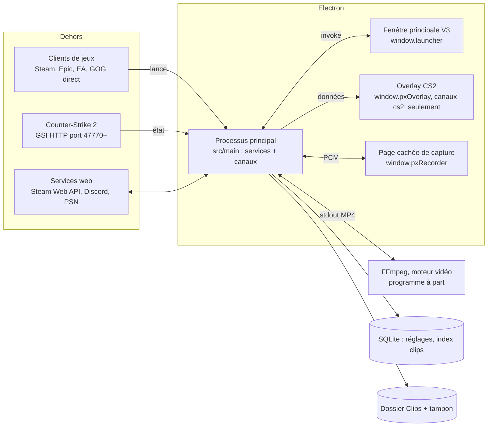
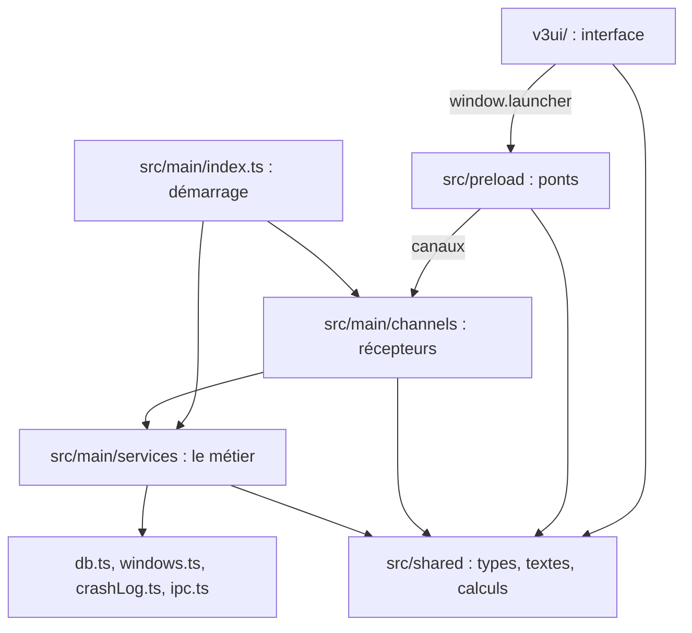
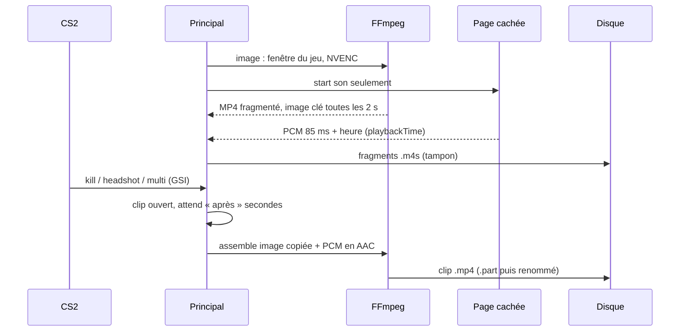

# Architecture de Player X V3 Test

À jour au 13/11/2026, après la revue d'architecture (lot « Fondations », posé sur la bêta 46). Les chiffres sont ceux de ce
jour-là ; les règles, elles, sont vérifiées à chaque `npm test` : si ce fichier et un test se contredisent, c'est le test qui
a raison.

## En une page

Player X est un lanceur de jeux pour Windows, fait avec Electron. Il a quatre morceaux :

| Morceau | Dossier | Rôle |
| --- | --- | --- |
| L'interface | `v3ui/` | Ce que tu vois. JS et CSS sans framework, assemblés en un seul fichier par `python3 v3ui/build.py`. |
| Le pont | `src/preload/` | La seule porte entre une page et le moteur. Une page ne peut appeler que ce que son pont expose. |
| Le moteur | `src/main/` | Le processus principal : jeux, lancements, clips, films, comptes, base de données. |
| Les règles partagées | `src/shared/` | Types, textes et calculs utilisés à la fois par le moteur, le pont et l'interface. |

À côté : `src/renderer/` (overlay CS2 et page cachée de capture), `installer/` (installeur Go + WebView2), `scripts/`
(construction), `tools/` (scénarios d'essai sur la vraie appli).

## Processus et ponts

- Un seul processus principal fait le travail. Chaque fenêtre est isolée (`sandbox`, `contextIsolation`) et ne reçoit que son pont.
- Les trois pages ont une politique de contenu stricte : scripts du fichier local seulement.
- FFmpeg est livré avec l'appli ; son empreinte est vérifiée avant chaque lancement (`src/shared/ffmpegPin.json`).

## Les couches et leurs règles

Règles tenues par `src/main/architecture.test.ts` (elles lisent les imports des fichiers, rien n'est listé à la main) :

1. `src/shared` ne dépend de rien : ni paquet, ni Electron, ni Node, ni le reste de l'appli.
2. Le pont et les pages ne voient que `src/shared` (et Electron pour le pont).
3. Personne n'importe le démarrage (`main/index.ts`) ; un service n'importe jamais un canal.
4. Aucun import en boucle. Si deux fichiers ont besoin l'un de l'autre, celui du bas reçoit ce qu'il lui faut au démarrage
   (exemple : `setEngineHost` dans `services/editFfmpeg.ts`, branché par `index.ts`).

Deux façons d'écrire un service cohabitent. À préférer pour tout nouveau code : la première.

- **Règles pures** (32 fichiers sur 69 dans `services/`) : elles ne touchent jamais Electron, même par ricochet ; tout ce dont le
  fichier a besoin lui est passé. Elles se testent en quelques secondes avec `npm test` (29 ont leur fichier de tests). Modèle
  à suivre : `launches.ts` (il reçoit `LaunchDeps`), `clipsPlan.ts`, `fmp4.ts`, `settingsRules.ts`.
- **Services branchés sur Electron** (37 fichiers) : ils gardent leur état dans des variables du fichier et se démarrent par
  `startXxx()`. Ils ne se vérifient que sur la vraie appli (`tools/essais`). Le plus gros est `clips.ts` (1 971 lignes).

## Le démarrage, dans l'ordre

`src/main/index.ts` ne fait plus que ça (220 lignes). L'ordre compte, il est commenté ligne par ligne dans le fichier.

1. Avant qu'Electron soit prêt : capture WGC sous Windows, `.env` en développement seulement, mode démo interdit dans la
   version installée, navigation verrouillée (`security.ts`), identifiant Windows, instance unique.
2. `db.initDb()` : la base est lue en mémoire.
3. `lockDown()` : permissions refusées, menu réduit.
4. `startLaunches()` (`launchHost.ts`) : l'orchestrateur de lancements, avant les canaux.
5. Écritures de secours de la base : mise en veille, fermeture, arrêt de Windows.
6. `setEngineHost(…)` puis `registerIpc()` : les canaux sont ouverts.
7. Les services : routines, bilans Battlefield 6, CS2 en direct, overlay, clips, temps de jeu, enregistreurs de stats,
   actus, succès, événements, mises à jour Steam, bibliothèque Steam, icône près de l'horloge.
8. `createMainWindow()` (`mainWindow.ts`), puis le jeu demandé par un raccourci Windows s'il y en a un.

Un démarrage raté affiche un message, écrit dans `erreurs.log` et ferme l'appli.

## Carte du moteur (`src/main`)

| Fichier | Rôle |
| --- | --- |
| `index.ts` | Le démarrage, et rien d'autre. |
| `security.ts` | Ce que les pages n'ont pas le droit de faire : permissions, navigation, fenêtres ouvertes par une page. |
| `mainWindow.ts` | La fenêtre principale : taille, échelle, barre de titre. |
| `launchHost.ts` | Branche `services/launches.ts` (pur) sur la vraie appli : fenêtre, relevé des programmes, bibliothèque. |
| `ipc.ts` + `ipcRules.ts` | `handle()` : vérifie d'où vient chaque appel, note les pannes inattendues dans le journal. |
| `trust.ts` | L'adresse d'une page de confiance. |
| `windows.ts` | Les fenêtres ouvertes, et les envois vers elles (`broadcast`, `sendTo`). |
| `db.ts` | SQLite en mémoire (sql.js), écrite sur disque 1,5 s après un changement, avec copie de secours. |
| `crashLog.ts` + `crashLogRules.ts` | `logError()` : le journal `erreurs.log`. |
| `channels/` | Les récepteurs des appels de l'interface, un fichier par domaine. |
| `services/` | Le métier, un ou plusieurs fichiers par domaine (ci-dessous). |

Les services, par domaine :

- **Bibliothèque** : `library.ts` (les jeux vus par toute l'appli, le scan, « quels jeux tournent »), `games.ts` (Steam, Epic, EA,
  GOG), `gogInfo.ts`, `artwork.ts`, `steamLibrary.ts`, `steamUpdates.ts`, `shelves.ts`, `recentGames.ts`, `demo.ts`.
- **Lancement et temps de jeu** : `launches.ts`, `launchWatch.ts`, `launchWatchParse.ts`, `tracking.ts`, `playtime.ts`.
- **Clips** : `clips.ts`, `clipsPlan.ts`, `fmp4.ts`, `engineCapture.ts`, `cs2Moments.ts`, `clipsProtocol.ts`, `clipsToast.ts`,
  `clipsLog.ts`, `captureTest.ts`.
- **Films** : `editFfmpeg.ts` (le moteur vidéo), `editFilm.ts`, `editPlan.ts`, `editCompile.ts`, `editBeats.ts`, `editMusic.ts`,
  `editEngineRules.ts`.
- **Counter-Strike 2** : `cs2Live.ts`, `cs2Match.ts`, `cs2Gsi.ts`, `cs2Overlay.ts`, `cs2Lifetime.ts`.
- **Battlefield 6** : `stats.ts`, `bf6Recap.ts`, `bf6Diff.ts`, `bf6Loadouts.ts`.
- **Comptes, amis, actus** : `auth.ts`, `friends.ts`, `discordMembers.ts`, `steamProfile.ts`, `news.ts`, `newsFeed.ts`,
  `newsFormat.ts`, `achievements.ts`, `events.ts`, `servers.ts`, `alerts.ts`.
- **Appli** : `settings.ts`, `settingsRules.ts`, `routines.ts`, `routineRules.ts`, `tray.ts`.
- **Développement seulement** (jamais dans l'installeur) : `launchSim.ts`, `*Sim.ts`.

## Le contrat entre les pages et le moteur

Trois sortes de messages, toutes avec un nom de la forme `domaine:action` :

- **Appels** (96) : la page demande, le moteur répond. `ipcRenderer.invoke('games:list')` côté pont, `handle('games:list', …)`
  côté moteur. `handle()` refuse tout appel qui ne vient pas d'une page de l'appli, et tout canal hors `cs2:` depuis l'overlay.
- **Messages du moteur** (21) : `broadcast('games:changed')`, écoutés par `ipcRenderer.on(…)` dans le pont.
- **Envois de la page de capture** (9, `clips-rec:*`) : le flux vidéo et le son, sans réponse.

`src/main/ipcContract.test.ts` relit les deux côtés à chaque `npm test` : chaque appel a un récepteur et un seul, chaque
message a son écoute, l'interface n'appelle que ce que le pont expose. Un nom changé d'un seul côté fait échouer le test au
lieu de donner un bouton qui ne répond plus.

Ajouter un appel, en quatre gestes :

1. Sa signature dans `src/shared/types/api.ts` (`LauncherApi`).
2. Sa ligne dans `src/preload/index.ts`.
3. Son récepteur dans le bon fichier de `src/main/channels/`. Ce que la page envoie arrive en `unknown` : le récepteur
   vérifie avant de s'en servir (le compilateur refuse l'inverse). Un refus pour la personne s'écrit `throw new UserError('…')`.
4. `npm test`.

## Les trois parcours

### 1. Lancer un jeu
`scanAllGames` (Steam, Epic, EA, GOG en parallèle) → bibliothèque (`library.ts`) → `launchTarget` (lien du magasin, ou exe +
arguments pour GOG) → `handoff` (Windows) → `launches.ts` suit les états `sending → waiting → (relay) → running → ended` (autres :
early-exit, gave-up, failed, already, resent, cancelled, untracked) ; `playtime` et `tracking` reconnaissent le jeu par son
exécutable.

### 2. Faire un clip

- Essais d'image : fenêtre du jeu → écran WGC → copie de bureau ; NVENC puis AMF ; si rien ne marche, retour à la capture de Chrome.
- À ne pas refaire : `scale_d3d11` ; recoller le son de MediaRecorder ; compter les morceaux de son reçus au lieu d'utiliser `playbackTime`.

### 3. Monter un film
Page Clips (sélection) → éditeur `edit.js` (musique, rythme, déplacer, ralentir, supprimer) → `detectBeats` → `planProject` /
`editShots` → `shotArgs` + `joinArgs` → `editFilm` lance FFmpeg. Limites : 48 plans, 10 minutes.

Le moteur des films (`filmEngine` dans `editFfmpeg.ts`) ne fait qu'un travail à la fois : un film, un essai du moteur, ou la
copie légère d'un clip pour Discord (`clipsShare.ts`, règles dans `sharePlan.ts`). Celui qui arrive pendant qu'un autre tient
le moteur est refusé avec la raison. La capture des clips lance son propre FFmpeg, à part (`spawnCaptureEngine`).

## Données

- **Base** : SQLite dans `%APPDATA%\Player X V3 Test`, lue en entier en mémoire. Tables `games`, `launches`, `sessions`, et une
  table `kv` (clé → JSON) qui sert de fourre-tout : une trentaine de clés, écrites par vingt et un fichiers (`settings`, `clipsIndex`,
  `cs2Recaps`, `bf6Cache`…). Les clés et jetons y sont chiffrés par Windows (`safeStorage`).
- **Fichiers** : clips et films dans le dossier choisi dans Paramètres ; tampon vidéo dans le dossier temporaire.
- **Journaux** : `erreurs.log` (pannes du moteur, 256 Ko au plus, la moitié la plus récente est gardée ; une erreur qui se répète
  n'y est écrite qu'une fois toutes les dix minutes, avec son compte) et `logs\clips.log` (vie de la capture).
  Ce que le moteur écrit avec `console.*` ne se voit qu'en développement : une panne se note avec `logError('où', e)`.

## Tests et garde-fous

- `npm run typecheck` puis `npm test`. `npm test` trouve tout seul chaque `*.test.ts` de `src/` (`scripts/test-all.mjs`) :
  un test ajouté tourne sans rien inscrire nulle part. `npm test -- clips` ne lance que les fichiers dont le chemin contient
  « clips ». Les scripts `test:launch`, `test:clips`… restent pour lancer un groupe.
- Garde-fous qui lisent le code : `architecture.test.ts` (couches, boucles), `ipcContract.test.ts` (canaux),
  `src/renderer/src/styles/tokens.test.ts` (thème).
- La vraie appli : `tools/essais` (a1 à a18, la fenêtre sous Xvfb) et `tools/essais-clips` (capture, clips, films). Ils
  demandent `npm run build` avant. Une compilation réussie ne prouve pas la stabilité : après un changement du moteur, ce sont
  eux qui comptent.
- Lire la sortie d'un scénario, pas seulement son code de sortie : un scénario `a*` qui attrape une panne écrit « ECHEC » et
  rend quand même 0. Au 14/11/2026, sept scénarios ne vont plus au bout sur `main` : a4, a8, a9, a10 et a12 sont en retard sur
  l'interface, a16 appelle sur l'appli empaquetée un outil d'essai qu'elle n'a jamais (`pxClipsTest`), t1-basics appelle un
  outil absent du dépôt (`tools/clipslab/dump.cjs`).

## Construire

`python3 v3ui/build.py` → electron-vite → `scripts/fetch-ffmpeg.mjs` → NSIS (classique) + `installer/` Go/WebView2 (V3).
`npm run dist` enchaîne tout. Détail : `NOTES.md`.

## Dettes connues

Classées et chiffrées dans la revue d'architecture du 13/11/2026 (document « Player X : revue d'architecture »). Les
principales, dans l'ordre proposé :

1. `clips.ts` fait au moins onze métiers en 1 971 lignes (1 824 avant la bêta 46) et ne se vérifie que sur la vraie appli : à
   découper, une pièce à la fois.
2. Un appel s'écrit encore à la main à trois endroits (`types/api.ts`, pont, récepteur) : une seule table typée suffirait.
3. Les services n'ont pas d'arrêt propre (douze minuteries, la fermeture de l'appli gérée à six endroits dans cinq fichiers).
4. L'interface V3 : 21 fichiers dans un seul espace global, sans contrôle de types.
5. La base n'a pas de numéro de version de schéma.
6. Sept scénarios de la vraie appli ne vont plus au bout, et un scénario qui échoue rend quand même 0 : à remettre à jour, avec
   un code de sortie qui dit la vérité.
