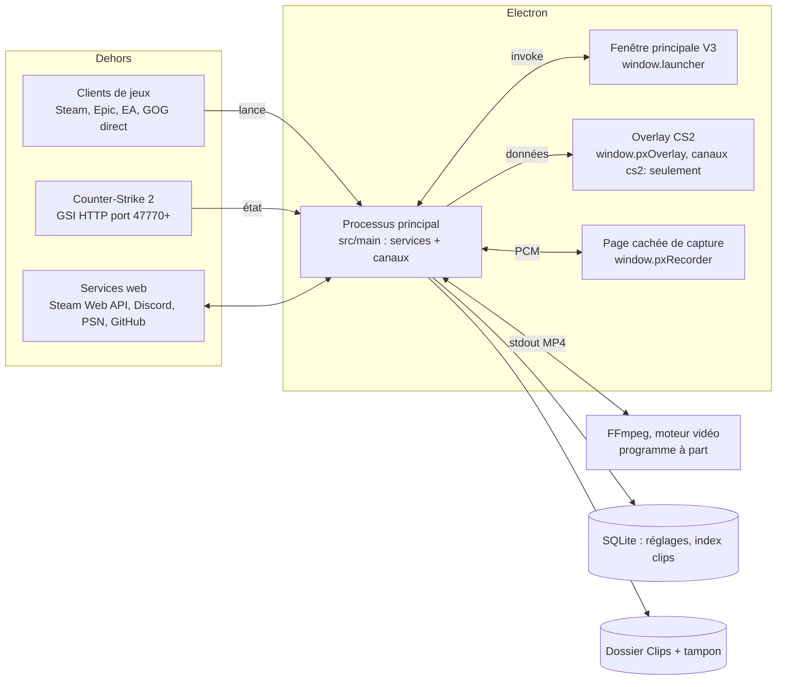
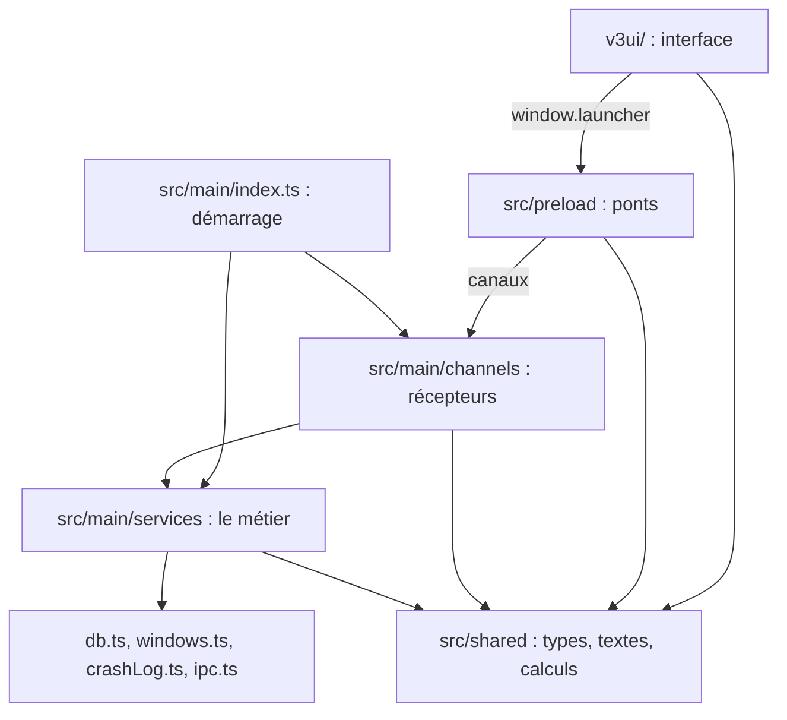
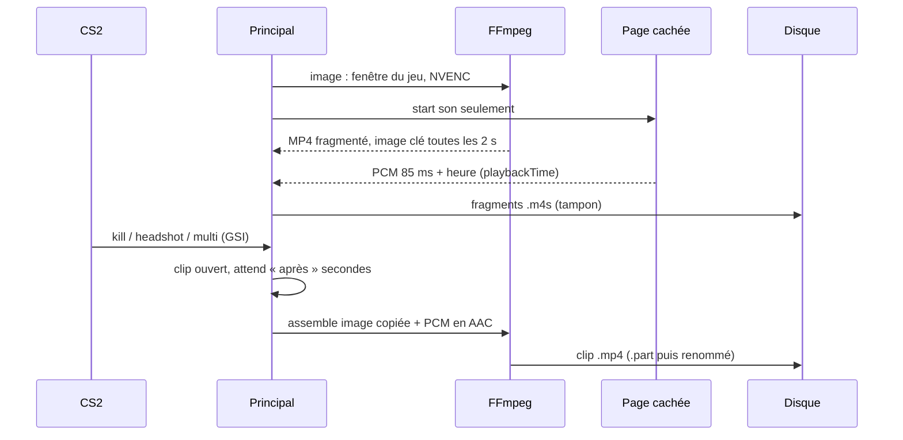

# Architecture de Player X V3 Test

À jour au 20/11/2026, sur la version `0.7.6` (après les lots 0.7.x et l'audit Priorités 1 à 4). Les règles d'architecture et
le contrat IPC sont vérifiés à chaque `npm test` : si ce fichier et un test se contredisent, c'est le test qui a raison.

## En une page

Player X est un lanceur de jeux pour Windows, fait avec Electron. Il a quatre morceaux :

| Morceau | Dossier | Rôle |
| --- | --- | --- |
| L'interface | `v3ui/` | Ce que tu vois. JS et CSS sans framework, typés par `tsconfig.v3ui.json`, assemblés en Node pur par `node v3ui/build.mjs`. |
| Le pont | `src/preload/` | La seule porte entre une page et le moteur. Une page ne peut appeler que ce que son pont expose. |
| Le moteur | `src/main/` | Le processus principal : jeux, lancements, clips, films, comptes, mises à jour, Mon PC, base de données. |
| Les règles partagées | `src/shared/` | Types, textes et calculs utilisés à la fois par le moteur, le pont et l'interface. |

À côté : `src/renderer/` (overlay CS2 et page cachée de capture), `installer/` (installeur Go + WebView2), `scripts/`
(construction, tests, publication), `tools/` (scénarios d'essai sur la vraie appli), `.github/workflows/ci.yml` (CI).

## Processus et ponts

- Un seul processus principal fait le travail. Chaque fenêtre est isolée (`sandbox`, `contextIsolation`) et ne reçoit que son pont.
- Les trois pages ont une politique de contenu stricte : scripts du fichier local seulement.
- Les fenêtres auxiliaires (`isAuxiliary` : capture cachée, pastilles) sont refusées sur tous les canaux `handle()`.
- FFmpeg est livré avec l'appli ; son empreinte est vérifiée avant chaque lancement (`src/shared/ffmpegPin.json`).

## Les couches et leurs règles

Règles tenues par `src/main/architecture.test.ts` et `src/main/ipcContract.test.ts` (elles lisent les fichiers tels quels, rien n'est listé à la main) :

1. `src/shared` ne dépend de rien : ni paquet, ni Electron, ni Node, ni le reste de l'appli.
2. Le pont et les pages ne voient que `src/shared` (et Electron pour le pont).
3. Personne n'importe le démarrage (`main/index.ts`) ; un service n'importe jamais un canal.
4. Aucun import en boucle. Si deux fichiers ont besoin l'un de l'autre, celui du bas reçoit ce qu'il lui faut au démarrage
   (exemple : `setEngineHost` dans `services/editFfmpeg.ts`, branché par `index.ts`).
5. Tous les récepteurs `handle()` vivent exclusivement dans `src/main/channels/`.

Deux façons d'écrire un service cohabitent. À préférer pour tout nouveau code : la première.

- **Règles pures** (`*Rules.ts`, `launches.ts`, `clipsPlan.ts`, `fmp4.ts`, `clipsFiles.ts`, `clipsQueue.ts`, `updaterRules.ts`, `pcRules.ts`…) : elles ne touchent jamais Electron, même par ricochet ; tout ce dont le fichier a besoin lui est passé. Elles se testent en quelques secondes avec `npm test`.
- **Services branchés sur Electron** : ils gardent leur état dans des variables du fichier et se démarrent par `startXxx()`. Ils se vérifient sur la vraie appli (`tools/essais`). Quand plusieurs fichiers lisent le même état, un seul le garde et l'écrit ; les autres le lisent par une fonction (`getSettings()`, `clipSettings()`, `clipIndex()`), jamais par une variable exportée.

## Le démarrage, dans l'ordre

`src/main/index.ts` orchestre le démarrage et la fermeture, dans un ordre commenté ligne par ligne :

1. Avant qu'Electron soit prêt : capture WGC sous Windows, `.env` en développement seulement, mode démo interdit dans la
   version installée, navigation verrouillée (`security.ts`), identifiant Windows, vérification d'une mise à jour en cours (`installInProgress`), instance unique.
2. `db.initDb()` : la base est lue en mémoire (avec index `idx_launches_game` et `idx_sessions_game` et sauvetage si abîmée).
3. `prepareUpdater()` puis `lockDown()` : permissions refusées, menu réduit.
4. `startLaunches()` (`launchHost.ts`) : l'orchestrateur de lancements, avant les canaux.
5. Écritures de secours synchrones (`db.flushDb()`) : mise en veille, fermeture, arrêt de Windows.
6. `setEngineHost(…)` puis `registerIpc()` : tous les canaux de `src/main/channels/` sont ouverts.
7. Les services : routines, bilans Battlefield 6, CS2 en direct, overlay, clips, temps de jeu, enregistreurs de stats,
   actus, succès, événements, mises à jour Steam, bibliothèque Steam, icône près de l'horloge, mises à jour de l'appli (`startUpdater`).
8. `createMainWindow()` (`mainWindow.ts`), puis le jeu demandé par un raccourci Windows s'il y en a un.

Un démarrage raté affiche un message, écrit dans `erreurs.log` et ferme l'appli.

## Carte du moteur (`src/main`)

| Fichier | Rôle |
| --- | --- |
| `index.ts` | Le démarrage, et rien d'autre. |
| `security.ts` | Ce que les pages n'ont pas le droit de faire : permissions, navigation, fenêtres ouvertes par une page. |
| `mainWindow.ts` | La fenêtre principale : taille, échelle, barre de titre. |
| `launchHost.ts` | Branche `services/launches.ts` (pur) sur la vraie appli : fenêtre, relevé des programmes, bibliothèque. |
| `ipc.ts` + `ipcRules.ts` | `handle()` : vérifie l'origine de chaque appel, bloque les fenêtres auxiliaires, note les pannes techniques inattendues (`DOMException`, réseau, SQLite, HTTP 5xx…) dans `erreurs.log`. |
| `trust.ts` | L'adresse d'une page de confiance. |
| `windows.ts` | Les fenêtres ouvertes (`appWindows`, `isOverlay`, `isAuxiliary`), et les envois vers elles (`broadcast`, `sendTo`). |
| `db.ts` | SQLite en mémoire (`sql.js`), clés `kv` typées (`KvKey`), persistance asynchrone en arrière-plan (`persistAsync`) et vidage synchrone garanti à la fermeture (`flushDb`), avec copie `.bak`. |
| `crashLog.ts` + `crashLogRules.ts` | `logError()` : le journal `erreurs.log`. |
| `channels/` | Tous les récepteurs `handle()` de l'interface, un fichier par domaine (`account`, `clips`, `cs2Overlay`, `edit`, `friends`, `library`, `maj`, `pc`, `play`). |
| `services/` | Le métier, un ou plusieurs fichiers par domaine (ci-dessous). |

Les services, par domaine :

- **Bibliothèque** : `library.ts`, `games.ts` (Steam, Epic, EA, GOG), `gogInfo.ts`, `artwork.ts`, `steamLibrary.ts`, `steamUpdates.ts`, `shelves.ts`, `recentGames.ts`, `demo.ts`.
- **Lancement et temps de jeu** : `launches.ts`, `launchWatch.ts`, `launchWatchParse.ts`, `tracking.ts`, `playtime.ts` (sondage `tasklist` léger au repos, escalade PowerShell seulement si un jeu candidat est détecté).
- **Clips** : `clips.ts`, `clipsState.ts`, `clipsWindow.ts`, `clipsBuffer.ts`, `clipsEngine.ts`, `clipsSave.ts`, `clipsIndex.ts`, `clipsQueue.ts`, `clipsFiles.ts`, `clipsSettings.ts`, `clipsPlan.ts`, `fmp4.ts`, `engineCapture.ts`, `cs2Moments.ts`, `clipsProtocol.ts`, `clipsToast.ts`, `clipsLog.ts`, `clipsCopy.ts`, `clipsShare.ts`, `sharePlan.ts`, `captureTest.ts`.
- **Films** : `editFfmpeg.ts`, `editFilm.ts`, `editPlan.ts`, `editCompile.ts`, `editBeats.ts`, `editMusic.ts`, `editEngineRules.ts`, `editMusicRules.ts`.
- **Counter-Strike 2** : `cs2Live.ts`, `cs2Match.ts`, `cs2Gsi.ts`, `cs2Overlay.ts`, `cs2Lifetime.ts`.
- **Battlefield 6** : `stats.ts`, `bf6Recap.ts`, `bf6Diff.ts`, `bf6Loadouts.ts`.
- **Mon PC & pilotes** : `pc.ts`, `pcDriver.ts`, `pcRules.ts`, `nvidiaProducts.ts`.
- **Mises à jour** : `updater.ts`, `updaterRules.ts`, `updaterKey.ts`.
- **Comptes, amis, actus** : `auth.ts`, `friends.ts`, `discordMembers.ts`, `steamProfile.ts`, `news.ts`, `newsFeed.ts`, `newsFormat.ts`, `achievements.ts`, `events.ts`, `servers.ts`, `alerts.ts`.
- **Appli** : `settings.ts`, `settingsRules.ts`, `routines.ts`, `routineRules.ts`, `tray.ts`.
- **Développement seulement** (jamais dans l'installeur) : `launchSim.ts`, `*Sim.ts`.

## Le contrat entre les pages et le moteur

Trois sortes de messages, toutes avec un nom de la forme `domaine:action` :

- **Appels** : la page demande, le moteur répond (`ipcRenderer.invoke(...)` côté pont, `handle(...)` côté `src/main/channels/`). `handle()` refuse tout appel qui ne vient pas d'une page de l'appli, bloque les fenêtres auxiliaires, et limite l'overlay aux canaux `cs2:`.
- **Messages du moteur** : `broadcast(...)` / `sendTo(...)`, écoutés par `ipcRenderer.on(...)` dans le pont.
- **Envois de la page de capture** (`clips-rec:*`) : le flux vidéo et le son, sans réponse.

Deux vérifications automatiques garantissent ce contrat :
- `src/main/ipcContract.test.ts` vérifie à chaque `npm test` que chaque appel a un récepteur unique dans `src/main/channels/`, que chaque message a son écoute, et que `v3ui` n'appelle que ce que le pont expose.
- `tsconfig.v3ui.json` + `v3ui/types.d.ts` vérifient statiquement les appels `window.launcher.*` et `Shared.*` de `v3ui/src/*.js` face à `LauncherApi` et `v3ui/shared-entry.ts`.

Ajouter un appel, en quatre gestes :

1. Sa signature dans `src/shared/types/api.ts` (`LauncherApi`).
2. Sa ligne dans `src/preload/index.ts`.
3. Son récepteur dans le bon fichier de `src/main/channels/`. Ce que la page envoie arrive en `unknown` : le récepteur vérifie avant de s'en servir. Un refus pour la personne s'écrit `throw new UserError('…')`.
4. `npm run typecheck && npm test`.

## Les trois parcours

### 1. Lancer un jeu
`scanAllGames` (Steam, Epic, EA, GOG en parallèle) → bibliothèque (`library.ts`) → `launchTarget` (lien du magasin, ou exe + arguments pour GOG) → `handoff` (Windows) → `launches.ts` suit les états `sending → waiting → (relay) → running → ended` ; `playtime` et `tracking` reconnaissent le jeu par son exécutable.

### 2. Faire un clip

- Essais d'image : fenêtre du jeu → écran WGC → copie de bureau ; NVENC puis AMF ; si rien ne marche, retour à la capture de Chrome.
- À ne pas refaire : `scale_d3d11` ; recoller le son de MediaRecorder ; compter les morceaux de son reçus au lieu d'utiliser `playbackTime`.

### 3. Monter un film
Page Clips (sélection) → éditeur `edit.js` (brouillons, musique `pxclip://music/`, tempo, déplacer, ralentir, supprimer) → `detectBeats` → `planProject` / `editShots` → `shotArgs` + `joinArgs` → `editFilm` lance FFmpeg. Limites : 48 plans, 10 minutes.

Le moteur des films (`filmEngine` dans `editFfmpeg.ts`) ne fait qu'un travail à la fois : un film, un essai du moteur, ou la copie légère d'un clip pour Discord (`clipsShare.ts`, règles dans `sharePlan.ts`, demandée par `clipsCopy.ts`). La capture des clips lance son propre FFmpeg, à part (`spawnCaptureEngine`).

## Données

- **Base** : SQLite dans `%APPDATA%\Player X V3 Test`, lue en mémoire (`sql.js`). Tables `games`, `launches` (index `idx_launches_game`), `sessions` (index `idx_sessions_game`), et une table `kv` dont toutes les clés sont typées par `KvKey` (`src/main/db.ts`). Les clés et jetons y sont chiffrés par Windows (`safeStorage`). Écriture asynchrone en arrière-plan (`persistAsync`), écriture synchrone garantie sur mise en veille / fermeture (`flushDb`).
- **Fichiers** : clips et films dans le dossier choisi dans Paramètres ; tampon vidéo dans le dossier temporaire ; pilotes NVIDIA dans `userData/pilotes` ; mises à jour dans `userData/mise-a-jour`.
- **Journaux** : `erreurs.log` (pannes du moteur, 256 Ko au plus, la moitié la plus récente est gardée ; une erreur qui se répète n'y est écrite qu'une fois toutes les dix minutes, avec son compte) et `logs\clips.log` (vie de la capture).

## Tests, types et garde-fous

- `npm run typecheck` : vérifie `tsconfig.node.json` (moteur, preload, shared et tests renderer), `tsconfig.web.json` (overlay/renderer), `tsconfig.scripts.json` (`scripts/*.mjs` et `v3ui/build.mjs`) et `tsconfig.v3ui.json` (`v3ui/src/*.js` et `clips-recorder.js` face à `LauncherApi` et `Shared`).
- `npm test` : lance tous les `*.test.ts` de `src/` via `scripts/test-all.mjs` et `scripts/test-resolve.mjs` (zéro avertissement de module typeless). `npm test -- clips` filtre par mot.
- Garde-fous statiques : `architecture.test.ts` (couches, boucles), `ipcContract.test.ts` (canaux, tous dans `channels/`), `src/renderer/src/styles/tokens.test.ts` (thème et contrastes).
- Scénarios sur la vraie appli (Linux + Xvfb + Playwright) : `npm run build` puis `node tools/essais/tous.cjs` lance `a1..a18`, les 17 scénarios nommés (`nommes` : `amis`, `cx`, `ed`, `garde`, `hx`, `maj`, `pe`, `stats-cockpit`, `stats-etats`, `witcher`…) et `tools/essais-clips/t0..t26`.
- Intégration continue : `.github/workflows/ci.yml` exécute `typecheck`, `test`, `build` et la compilation croisée Windows x64 de `installer/` sur chaque push (`main`) et PR.

## Construire et publier

`node v3ui/build.mjs` → `electron-vite build` → `scripts/fetch-ffmpeg.mjs` → NSIS (classique) + `installer/` Go/WebView2 (V3).
`npm run dist` enchaîne tout ; `npm run maj:publier` (ou `Publier.bat`) signe `maj.json`, joint `Player-X-Setup-<v>.exe` et `Player-X-Installer-<v>.exe` (s'il est présent), et crée la Release GitHub (automatiquement en `prerelease` + `make_latest: false` pour une préversion semver). Détail : `NOTES.md`.

## Dettes restantes

Une grande partie de la revue d'architecture du 13/11/2026 a été soldée (`clips.ts` découpé et canaux extraits dans `channels/`, typage `checkJs` sur `v3ui/` + `clips-recorder.js`, clés `kv` typées, build sans Python, CI GitHub Actions). Il reste :

1. Un appel IPC s'écrit encore dans `types/api.ts`, `src/preload/index.ts` et `src/main/channels/*.ts` (protégé par `ipcContract.test.ts` et `tsconfig.v3ui.json`, mais sans générateur unique).
2. Un cycle de vie d'arrêt unifié pour les services d'arrière-plan (les minuteries et fermetures restent réparties dans leurs services respectifs).
3. Un numéro de version de schéma explicite dans la base SQLite (`PRAGMA user_version`) pour les futures migrations structurelles.
